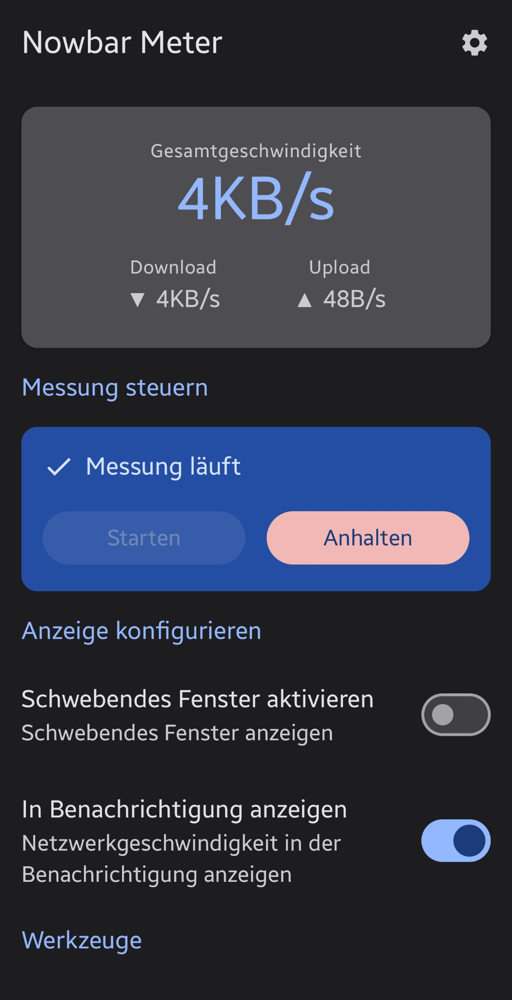

# Nowbar Meter

<p align="center">
  
</p>

A network speed monitor for Android, with Samsung Now Bar support, status-bar notification and a floating window.

This continuation preserves realMoai's NowbarMeter v1.3 via [joelsubash2000's fork](https://github.com/joelsubash2000/NowbarMeter). It uses its own application ID, `de.teddybaerd.nowbarmeter`.

## Screenshots

### Current app — German interface

<p align="center">
  
</p>

### Original screenshots

<div align="center">
  
  
</div>
<br>
<div align="center">
  
  <p><em>Native integration directly into the One UI status bar.</em></p>
</div>

## Download and installation

Download `NowbarMeter-v1.4.0-standard.apk` from [Releases](https://github.com/teddybaerd/NowbarMeter/releases). Grant notification permission and enable monitoring. Autostart after reboot is optional in settings. For reliable background operation, allow unrestricted battery use when prompted.

The original realMoai app can remain installed, but stop its monitoring service before using this app. The earlier debug test build uses a different signing key: uninstall that test build before installing a release, and record any settings first. Future releases use one persistent signing key so updates can be installed normally.

## Features

- Live upload, download or combined speed in a notification, status icon or floating window.
- Samsung Now Bar pill and lockscreen integration on supported firmware.
- Configurable sampling interval, units, fonts, colors and low-traffic behavior.
- Optional autostart after reboot.
- Complete German and English interface; additional inherited translations may be incomplete.
- Update checks against this repository, with APK selection for the installed variant.

## Compatibility

Android 12 or newer is required. Standard status icons and notifications work on older devices; the Samsung Now Bar requires supported One UI firmware. The own-package test build was confirmed by the maintainer to show the pill on Android 17 and the status icon on Android 12. Reboot autostart and extended standby were also tested successfully. These observations do not guarantee compatibility with every Samsung firmware.

The default standard build does not impersonate Kakao T. A legacy `compat` build flavor retains `com.kakao.taxi` for possible compatibility investigations, but is not distributed in this release. That flavor can trigger unofficial-copy detections and conflicts with the real Kakao T app or an original NowbarMeter installation. Samsung-specific notification metadata is still used in both flavors.

## Network access

The app checks GitHub Releases for updates. The optional speed-test button opens Cloudflare's speed-test website in a browser tab; the background-help button opens dontkillmyapp.com. Speed measurement uses Android traffic counters and filters virtual VPN interfaces. This describes the inspected source, not an independent audit or a claim about the original APK.

## Build

Use JDK 21 and Android SDK 36:

```sh
python3 tools/check_translations.py
bash gradlew :app:assembleStandardDebug :app:lintStandardDebug
```

The CI artifact is a debug test build, not the production signing identity.

For signed builds, the `Signed APK` workflow runs only on `master`. It first builds and lints the unsigned APK without secrets. A separate job in the `release-signing` environment downloads that artifact, verifies its checksum, and signs it without checking out or running project source. Configure `NOWBAR_KEYSTORE_BASE64`, `NOWBAR_STORE_PASSWORD`, `NOWBAR_KEY_ALIAS` and `NOWBAR_KEY_PASSWORD` as environment secrets, and restrict that environment to `master`.

The public signing certificate is in `signing/release-certificate.pem`; both signing and publication check its SHA-256 fingerprint. Back up the private key separately; never regenerate it for an update and never commit it or its passwords.

After testing the signed APK, manually run `Publish verified signed release` with the version, successful signing run ID, and exact source commit. This workflow has no access to the signing environment. It verifies the artifact, APK signature, package, version and checksums before publishing the same APK. Building or signing alone does not publish a release.

## Credits and license

Original Android speed monitor: [Pixel Meter / Mystery00 and contributors](https://github.com/Pixel-Tailor-CN/PixelMeter). Samsung adaptations and v1.3: realMoai. Preserved source: joelsubash2000. Continuation, independent package identity and German translation: teddybaerd.

This continuation is maintained by teddybaerd with assistance from OpenAI's ChatGPT/Codex for development, troubleshooting, translations and documentation. Project decisions and device testing are handled by the maintainer.

Licensed under [Apache License 2.0](LICENSE). Original notices remain in the source history. This continuation changes namespace and build variants, update endpoints, translations, documentation and release automation.
